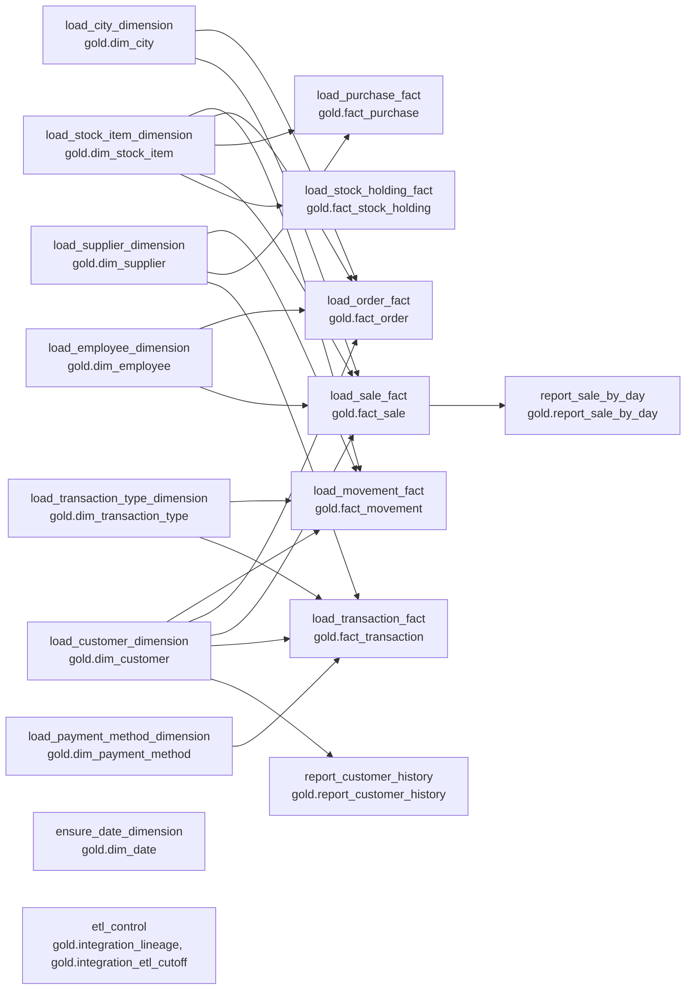

# daiwt-02 estate map

Legacy: [daiwt-02-enterprise-etl](https://github.com/Cognition-Partner-Workshops-mirror/daiwt-02-enterprise-etl) at `bb42a64`, SQL Server 2022 `WideWorldImporters` (OLTP) -> SSIS `DailyETLMain.dtsx` -> `WideWorldImportersDW`. Drops: D0 only. Plan: [`docs/units.yml`](units.yml).

Layering: every golden output is a DW table (`Dimension.*`, `Fact.*`, `Integration.*`) or a report over them, mapped to `gold.*`. The legacy `Integration.*_Staging` tables have no golden, so they stay inside their unit and there are **no Silver units**. 17 gold units own 18 outputs; facts read the dimension outputs, reports read facts/dimensions.

| Legacy job (DailyETLMain.dtsx container / source) | Unit | Target tables | Golden files (golden_path) |
|---|---|---|---|
| Load City Dimension (`GetCityUpdates.sql`, `MigrateStagedCityData.sql`) | `load_city_dimension` | `gold.dim_city` | `outputs/D0/tables/Dimension.City.csv` |
| Load Customer Dimension (`GetCustomerUpdates.sql`, `MigrateStagedCustomerData.sql`) | `load_customer_dimension` | `gold.dim_customer` | `outputs/D0/tables/Dimension.Customer.csv` |
| Load Employee Dimension (`GetEmployeeUpdates.sql`, `MigrateStagedEmployeeData.sql`) | `load_employee_dimension` | `gold.dim_employee` | `outputs/D0/tables/Dimension.Employee.csv` |
| Load Payment Method Dimension (`GetPaymentMethodUpdates.sql`, `MigrateStagedPaymentMethodData.sql`) | `load_payment_method_dimension` | `gold.dim_payment_method` | `outputs/D0/tables/Dimension.Payment_Method.csv` |
| Load Stock Item Dimension (`GetStockItemUpdates.sql`, `MigrateStagedStockItemData.sql`) | `load_stock_item_dimension` | `gold.dim_stock_item` | `outputs/D0/tables/Dimension.Stock_Item.csv` |
| Load Supplier Dimension (`GetSupplierUpdates.sql`, `MigrateStagedSupplierData.sql`) | `load_supplier_dimension` | `gold.dim_supplier` | `outputs/D0/tables/Dimension.Supplier.csv` |
| Load Transaction Type Dimension (`GetTransactionTypeUpdates.sql`, `MigrateStagedTransactionTypeData.sql`) | `load_transaction_type_dimension` | `gold.dim_transaction_type` | `outputs/D0/tables/Dimension.Transaction_Type.csv` |
| Ensure Date Dimension includes current year | `ensure_date_dimension` | `gold.dim_date` | `outputs/D0/tables/Dimension.Date.csv` |
| Load Movement Fact (`GetMovementUpdates.sql`, `MigrateStagedMovementData.sql`) | `load_movement_fact` | `gold.fact_movement` | `outputs/D0/tables/Fact.Movement.csv` |
| Load Order Fact (`GetOrderUpdates.sql`, `MigrateStagedOrderData.sql`) | `load_order_fact` | `gold.fact_order` | `outputs/D0/tables/Fact.Order.csv` |
| Load Purchase Fact (`GetPurchaseUpdates.sql`, `MigrateStagedPurchaseData.sql`) | `load_purchase_fact` | `gold.fact_purchase` | `outputs/D0/tables/Fact.Purchase.csv` |
| Load Sale Fact (`GetSaleUpdates.sql`, `MigrateStagedSaleData.sql`) | `load_sale_fact` | `gold.fact_sale` | `outputs/D0/tables/Fact.Sale.csv` |
| Load Stock Holding Fact (`GetStockHoldingUpdates.sql`, `MigrateStagedStockHoldingData.sql`) | `load_stock_holding_fact` | `gold.fact_stock_holding` | `outputs/D0/tables/Fact.Stock_Holding.csv` |
| Load Transaction Fact (`GetTransactionUpdates.sql`, `MigrateStagedTransactionData.sql`) | `load_transaction_fact` | `gold.fact_transaction` | `outputs/D0/tables/Fact.Transaction.csv` |
| Calculate ETL Cutoff Time + Get Lineage Key / Update cutoff (all containers) | `etl_control` | `gold.integration_lineage`, `gold.integration_etl_cutoff` | `outputs/D0/tables/Integration.Lineage.csv`, `outputs/D0/tables/Integration.ETL_Cutoff.csv` |
| Capture report `sale-by-day` (deployment/rds/estate.py) | `report_sale_by_day` | `gold.report_sale_by_day` | `outputs/D0/reports/sale-by-day.csv` |
| Capture report `customer-history` (deployment/rds/estate.py) | `report_customer_history` | `gold.report_customer_history` | `outputs/D0/reports/customer-history.csv` |

## Builder notes

- Golden D0 is the restored DW at source cutoff `2016-06-06 12:31:17` (one load per entity, lineage keys 1-13). Rebuild from D0 bronze as one window `(2012-12-31, 2016-06-06 12:31:17]`; base + `_archive` bronze tables are the temporal history.
- Surrogate keys (`*_key`) and `lineage_key` are compared strictly; key 0 "Unknown" rows are part of every dimension golden.
- Fact dimension lookups use `ts > valid_from AND ts <= valid_to`, falling back to key 0; Stock Holding uses the latest version instead.
- Golden timestamps carry 7 fractional digits (`datetime2(7)`, end-of-time `9999-12-31 23:59:59.9999999`).

## Out of scope (no golden output)

- `sqlserver/` expanded batch (`stg`/`etl`/report views, aggregate and extra marts), `ssis/` package set other than `DailyETLMain.dtsx`, `oracle/`, SQL Agent job scripts, `workload-drivers/`, app/Power BI/SSAS folders and OLTP-only procedures (`Website.*`, `DataLoadSimulation.*`, `Sequences.*`).
- Unit-internal only (no golden): all `Integration.*_Staging` tables; procedure branches the capture recorded as skipped in `golden/manifest.json`.
