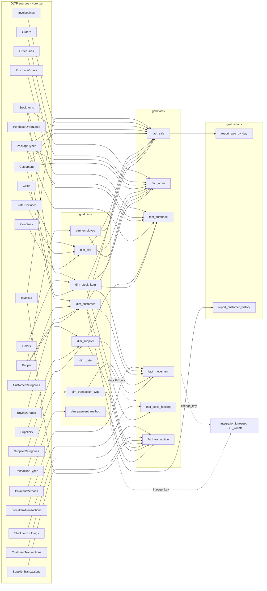

# WWI daily ETL: inventory, dependency graph and load order (Wave 0 / workstream a)

**Scope:** the 13-entity WWI daily ETL (8 dimensions, 6 facts, 2 Integration tables) and the 2 reports (customer-history, sale-by-day).

**Sources (read-only):**
- Legacy `Cognition-Partner-Workshops-mirror/daiwt-02-enterprise-etl` @ `bb42a64` (the same SHA as `golden/manifest.json` `source.legacy_commit`).
- Migration `Cognition-Partner-Workshops-mirror/daiwt-02-lakehouse-migration` `main` @ `dd46399`, using the `golden/` copy.

Paths below are relative to the legacy repo unless prefixed `mig:`.

**Conventions:**
- **[V]** means I verified it directly in the repo files or golden CSVs.
- **[I]** means it is an inference.
- `S` = `wwi-ssdt/wwi-ssdt/Integration/Stored Procedures/` (OLTP extract procs).
- `D` = `wwi-dw-ssdt/wwi-dw-ssdt/Integration/Stored Procedures/` (DW merge procs).
- `T` = `wwi-dw-ssdt/wwi-dw-ssdt/Integration/Tables/`.
- `P` = `wwi-ssis/wwi-ssis/DailyETLMain.dtsx`.

---

## 0. Headline facts

1. **[V] The in-scope ETL is the original Microsoft sample package `P`, which is a single SSIS package.** It contains 2 expression tasks, 1 Execute SQL task (the Date dimension) and 13 sequence containers, one per entity. Each container follows the same 5-step pattern (§3).
   - The expanded `ssis/` estate (205 packages, `Master_Daily_ETL`, etc.) is **not** what produced the goldens.
   - Agent job `sqlserver/agent/10_job_WWI_Daily_ETL.sql` runs `\SSISDB\…\Master_Daily_ETL.dtsx` (job step 2), not `DailyETLMain`.
   - `mig:golden/ssis_branches.json` records those branches as skipped because the live databases are missing their `etl.*`/`stg.*` procs.
2. **[V] How the goldens were produced:**
   - D0 outputs are the restored Microsoft `WideWorldImportersDW` baseline. Its lineage keys 1–13 are dated 2016-06-06 (`mig:golden/outputs/D0/tables/Integration.Lineage.csv`).
   - D1 and D2 were produced by `mig:golden/capture_sqlserver.py etl` (L661–700). That function re-implements the `P` control flow in T-SQL against the **live** procs, with fixed cutoffs: 2016-06-14 for D1 and 2016-06-21 for D2.
3. **[V] Repo SQL text vs the live database:**
   - The repo's SSDT text is only a reference. Some repo DDL does not match the live database the goldens came from.
   - Example: repo `Dimension.Date` (`wwi-dw-ssdt/wwi-dw-ssdt/Dimension/Tables/Date.sql`) has about 61 columns. The live table, and so golden `dim_date`, has **14** (manifest `source_columns`).
   - Example: live extract result sets (`mig:golden/native_destination_columns.json`, `native_result_sets.json`) match the `WITH RESULT SETS` blocks in `P`, not every repo proc body.
   - **The golden schema is the contract.**
4. **[V] Reports are not legacy objects.**
   - `sale-by-day` and `customer-history` are ad-hoc SELECTs defined in `mig:golden/capture_sqlserver.py` L40–51, mirrored from `deployment/rds/estate.py` L137–141.
   - `sale-by-day` = `Fact.Sale GROUP BY [Invoice Date Key]` (COUNT, SUM `Total Including Tax`).
   - `customer-history` = projection of `Dimension.Customer`.
   - I recomputed D2 `sale-by-day` from D2 `Fact.Sale`: an exact match on 1,081 rows. **[V]**

---

## 1. In-scope object inventory

### 1a. OLTP source tables (WideWorldImporters): bronze candidates

All 38 golden input files (`mig:golden/inputs/D0/*.csv`, manifest `files`) are consumed (§5). The DDL for each table is at `wwi-ssdt/wwi-ssdt/<Schema>/Tables/<Table>.sql`.

| Source table (+ temporal history) | D0 rows | Read by (extract proc) | Feeds golden output(s) |
|---|---|---|---|
| Application.Cities (+ _Archive) | 37,940 / 28 | GetCityUpdates | dim_city → fact_order, fact_sale |
| Application.StateProvinces (+ _Archive) | 53 / 104 | GetCityUpdates | dim_city |
| Application.Countries (+ _Archive) | 190 / 37 | GetCityUpdates | dim_city |
| Sales.Customers (+ _Archive) | 663 / 51 | GetCustomerUpdates; also GetOrderUpdates/GetSaleUpdates (DeliveryCityID) | dim_customer, customer-history; fact_order/fact_sale city lookup |
| Sales.CustomerCategories (+ _Archive) | 8 / 1 | GetCustomerUpdates | dim_customer |
| Sales.BuyingGroups (+ _Archive) | 2 / 0 | GetCustomerUpdates (LEFT JOIN) | dim_customer |
| Application.People (+ _Archive) | 1,111 / 961 | GetEmployeeUpdates (IsEmployee<>0); GetCustomerUpdates/GetSupplierUpdates (primary contact) | dim_employee, dim_customer, dim_supplier |
| Application.PaymentMethods (+ _Archive) | 4 / 1 | GetPaymentMethodUpdates | dim_payment_method |
| Application.TransactionTypes (+ _Archive) | 13 / 1 | GetTransactionTypeUpdates | dim_transaction_type |
| Warehouse.StockItems (+ _Archive) | 227 / 444 | GetStockItemUpdates; GetSaleUpdates (IsChillerStock); GetPurchaseUpdates (QuantityPerOuter) | dim_stock_item, fact_sale, fact_purchase |
| Warehouse.Colors (+ _Archive) | 36 / 1 | GetStockItemUpdates (LEFT JOIN, AS OF) | dim_stock_item |
| Warehouse.PackageTypes (+ _Archive) | 14 / 0 | GetStockItemUpdates (AS OF); GetOrder/Sale/PurchaseUpdates (current) | dim_stock_item, fact_order, fact_sale, fact_purchase |
| Purchasing.Suppliers (+ _Archive) | 13 / 13 | GetSupplierUpdates | dim_supplier |
| Purchasing.SupplierCategories (+ _Archive) | 9 / 1 | GetSupplierUpdates | dim_supplier |
| Warehouse.StockItemTransactions | 236,667 | GetMovementUpdates | fact_movement |
| Sales.Orders, Sales.OrderLines | 73,595 / 231,412 | GetOrderUpdates | fact_order |
| Sales.Invoices, Sales.InvoiceLines | 70,510 / 228,265 | GetSaleUpdates; Invoices also in GetTransactionUpdates | fact_sale, sale-by-day, fact_transaction |
| Purchasing.PurchaseOrders, PurchaseOrderLines | 2,074 / 8,367 | GetPurchaseUpdates | fact_purchase |
| Warehouse.StockItemHoldings | 227 | GetStockHoldingUpdates (full snapshot) | fact_stock_holding |
| Sales.CustomerTransactions | 97,147 | GetTransactionUpdates | fact_transaction |
| Purchasing.SupplierTransactions | 2,438 | GetTransactionUpdates | fact_transaction |

**How the `_Archive` tables are used [V]:**
- Dimension extracts read `_Archive` tables explicitly in their change-detection cursors. For example, `S/GetCityUpdates.sql` L39–52, L79–94 and L121–134.
- They also read them implicitly through `FOR SYSTEM_TIME AS OF @ValidFrom` (e.g. GetCityUpdates L64–68).
- This is why the capture includes every temporal history table that an extract references (`mig:golden/capture_sqlserver.py` L431–441).

**OLTP tables that are not referenced by any extract and so not captured [V]:**
- Application.DeliveryMethods, SystemParameters, Logs
- Sales.SpecialDeals
- Warehouse.StockGroups, StockItemStockGroups, ColdRoomTemperatures, VehicleTemperatures

### 1b. Extract procs (OLTP `Integration` schema, `S/`)

| Proc | Params | Window predicate | Output → staging | Notes |
|---|---|---|---|---|
| GetCityUpdates.sql (181 lines) | @LastCutoff, @NewCutoff | `ValidFrom > @LastCutoff AND <= @NewCutoff`. Three cursors: country, state-province and city changes, with country/state-province changes also excluding `@InitialLoadDate` (L12) | City_Staging | SCD2 rows; Valid To = next Valid From for the same city, otherwise end-of-time |
| GetCustomerUpdates.sql (196) | same | buying-group, category and customer change cursors (L34–49, L82–97, L130–143) | Customer_Staging | Valid From/To come from the customer row (L156), then are recomputed (L181–185) |
| GetEmployeeUpdates.sql (86) | same | People `ValidFrom` window, `IsEmployee <> 0` (L29–44) | Employee_Staging | |
| GetPaymentMethodUpdates.sql (78) | same | ValidFrom window (L26–39) | PaymentMethod_Staging | |
| GetStockItemUpdates.sql (112) | same | StockItems/_Archive ValidFrom window (L42–53) | StockItem_Staging | ISNULL(Color/Brand/Size/Barcode, 'N/A') (L98–103) |
| GetSupplierUpdates.sql (135) | same | category + supplier cursors (L35–48, L77–88) | Supplier_Staging | |
| GetTransactionTypeUpdates.sql (78) | same | ValidFrom window (L28–39) | TransactionType_Staging | |
| GetMovementUpdates.sql (27) | same | `sit.LastEditedWhen` window (L22–23) | Movement_Staging | Date Key = CAST(TransactionOccurredWhen AS date) |
| GetOrderUpdates.sql (42) | same | `MAX(ol.LastEditedWhen, o.LastEditedWhen)` window (L37–38) | Order_Staging | Totals computed with ROUND (L18–23) |
| GetPurchaseUpdates.sql (34) | same | `MAX(line, header LastEditedWhen)` (L29–30) | Purchase_Staging | Ordered Quantity = OrderedOuters × QuantityPerOuter |
| GetSaleUpdates.sql (47) | same | `MAX(line, header LastEditedWhen)` (L42–43) | Sale_Staging | Ex-tax = ExtendedPrice − TaxAmount; dry/chiller split by IsChillerStock (L19–24) |
| GetStockHoldingUpdates.sql (20) | **none** | **no filter (full snapshot)** | StockHolding_Staging | |
| GetTransactionUpdates.sql (58) | same | CustomerTransactions / SupplierTransactions `LastEditedWhen` window, UNION ALL (L28–55) | Transaction_Staging | |

All windows are half-open `(LastCutoff, NewCutoff]`. **[V]**

### 1c. DW `Integration` objects (`wwi-dw-ssdt/wwi-dw-ssdt/Integration/`)

| Object | Type | Path | Role / feeds |
|---|---|---|---|
| Integration.[ETL Cutoff] | table (PK Table Name) | `T/ETL Cutoff.sql` | **Golden** Integration.ETL_Cutoff (14 rows: 13 entities plus `Date`). Seeded at 2012-12-31 by `wwi-dw-ssdt/wwi-dw-ssdt/PostDeploymentScripts/Script.PostDeployment1.sql` L25–35, which inserts one row for every Dimension/Fact table |
| Integration.Lineage | table (PK Lineage Key, default `NEXT VALUE FOR Sequences.LineageKey`) | `T/Lineage.sql` L1–9 | **Golden** Integration.Lineage (13 → 26 → 39 rows); lineage_key on every dim/fact row |
| Integration.{City,Customer,Employee,PaymentMethod,StockItem,Supplier,TransactionType,Movement,Order,Purchase,Sale,StockHolding,Transaction}_Staging | tables (identity staging PK; 12 are memory-optimized SCHEMA_ONLY, City is disk-based) | `T/<X>_Staging.sql` | Transient; the silver-layer equivalent |
| GetLastETLCutoffTime | proc | `D/GetLastETLCutoffTime.sql` L2–22 | Returns `[Cutoff Time]` for @TableName; THROW 51000 if missing |
| GetLineageKey | proc | `D/GetLineageKey.sql` L2–23 | INSERTs a Lineage row (Started = SYSDATETIME(), Completed NULL, Was Successful 0, Source System Cutoff Time = @NewCutoffTime) and returns the key |
| MigrateStaged{13}Data | procs | `D/MigrateStaged*.sql` | Merge staging → DW, complete Lineage, advance ETL Cutoff (§3) |
| PopulateDateDimensionForYear | proc | `D/PopulateDateDimensionForYear.sql` L1–160 | Inserts missing dates for one year into Dimension.Date |
| GenerateDateDimensionColumns | inline TVF | `wwi-dw-ssdt/wwi-dw-ssdt/Integration/Functions/GenerateDateDimensionColumns.sql` | Date attribute derivation; fiscal year starts 1 July (L121–168) |
| Sequences.{City,Customer,Employee,PaymentMethod,StockItem,Supplier,TransactionType,Lineage}Key | sequences | `wwi-dw-ssdt/wwi-dw-ssdt/Sequences/Sequences/*.sql` | Default surrogate keys for dims (`Dimension/Tables/*.sql` L2) and Lineage |
| Sequences.ReseedAllSequences / ReseedSequenceBeyondTableValues | procs | `wwi-dw-ssdt/wwi-dw-ssdt/Sequences/Stored Procedures/` | Deployment helpers only; not called by `P` |
| Unknown members (key 0) | seed rows | `Script.PostDeployment1.sql` L38 onward | Row 0 in each dimension (Valid From 2013-01-01, Valid To 9999-12-31) |

### 1d. DW target tables (`wwi-dw-ssdt/wwi-dw-ssdt/{Dimension,Fact}/Tables/`)

| DW table | Golden file (D2 path in manifest) | Golden table | D0 / D1 / D2 rows | Surrogate key |
|---|---|---|---|---|
| Dimension.City | Dimension.City.csv | gold.dim_city | 116,295 / 116,295 / 116,295 | Sequences.CityKey |
| Dimension.Customer | Dimension.Customer.csv | gold.dim_customer | 403 / 403 / 403 | Sequences.CustomerKey |
| Dimension.Date | Dimension.Date.csv | gold.dim_date | 1,461 / 1,461 / 1,461 (2013-01-01..2016-12-31) | natural key `Date` |
| Dimension.Employee | Dimension.Employee.csv | gold.dim_employee | 213 / 213 / 214 | Sequences.EmployeeKey |
| Dimension.[Payment Method] | Dimension.Payment_Method.csv | gold.dim_payment_method | 6 / 6 / 6 | Sequences.PaymentMethodKey |
| Dimension.[Stock Item] | Dimension.Stock_Item.csv | gold.dim_stock_item | 672 / 672 / 672 | Sequences.StockItemKey |
| Dimension.Supplier | Dimension.Supplier.csv | gold.dim_supplier | 28 / 28 / 28 | Sequences.SupplierKey |
| Dimension.[Transaction Type] | Dimension.Transaction_Type.csv | gold.dim_transaction_type | 15 / 15 / 15 | Sequences.TransactionTypeKey |
| Fact.Movement | Fact.Movement.csv | gold.fact_movement | 236,667 / 238,129 / 239,983 | BIGINT IDENTITY |
| Fact.[Order] | Fact.Order.csv | gold.fact_order | 231,412 / 232,838 / 234,667 | IDENTITY |
| Fact.Purchase | Fact.Purchase.csv | gold.fact_purchase | 8,367 / 8,415 / 8,471 | IDENTITY |
| Fact.Sale | Fact.Sale.csv | gold.fact_sale | 228,265 / 229,679 / 231,486 | IDENTITY |
| Fact.[Stock Holding] | Fact.Stock_Holding.csv | gold.fact_stock_holding | 227 / 227 / 227 | IDENTITY |
| Fact.[Transaction] | Fact.Transaction.csv | gold.fact_transaction | 99,585 / 100,290 / 101,132 | IDENTITY |
| (report) | reports/sale-by-day.csv | gold.report_sale_by_day | 1,069 / 1,075 / 1,081 | – |
| (report) | reports/customer-history.csv | gold.report_customer_history | 403 / 403 / 403 | – |
| Integration.[ETL Cutoff] | tables/Integration.ETL_Cutoff.csv | (Integration) | 14 / 14 / 14 | – |
| Integration.Lineage | tables/Integration.Lineage.csv | (Integration) | 13 / 26 / 39 | – |

The repo DDL defines `Date.sql` with about 61 columns, but the golden table has 14. Use the golden column list.

### 1e. SSIS package `P` (Daily ETL project `wwi-ssis/wwi-ssis/Daily ETL.dtproj`)

**Connections:**
- `WWI_Source_DB.conmgr` points to WideWorldImporters.
- `WWI_DW_Destination_DB.conmgr` points to WideWorldImportersDW.

**Variables (L25–55):** `LastETLCutoffTime`, `LineageKey`, `TableName`, `TargetETLCutoffTime`.

| Task | `P` line | What it does |
|---|---|---|
| Calculate ETL Cutoff Time backup (ExpressionTask) | L60–74 | `TargetETLCutoffTime = DATEADD("Minute",-5,GETUTCDATE())` (L72) |
| Trim Any Milliseconds (ExpressionTask) | L9947–9953 | Truncates milliseconds from `TargetETLCutoffTime` |
| Ensure Date Dimension includes current year (ExecSQL) | L80–89 | `EXEC Integration.PopulateDateDimensionForYear YEAR(SYSUTCDATETIME())` |
| Load City / Customer / Employee / Payment Method / Stock Item / Supplier / Transaction Type Dimension (Sequence) | L99, 883, 1575, 3894, 6786, 7784, 9425 | 5-step pattern (§3) |
| Load Movement / Order / Purchase / Sale / Stock Holding / Transaction Fact (Sequence) | L2189, 2891, 4416, 5115, 6181, 8471 | 5-step pattern (§3) |

No task in `P` has `Disabled` set. **[V]**

---

## 2. Per-entity chains: source → extract → staging → merge → DW → golden

| # | Golden output | OLTP sources | Extract proc (`S/`) | Staging (`T/`) | Merge proc (`D/`) | Load semantics in merge | Dim lookups (fact) |
|---|---|---|---|---|---|---|---|
| 1 | dim_city | Cities, StateProvinces, Countries (+archives) | GetCityUpdates | City_Staging | MigrateStagedCityData | SCD2: close the current row (Valid To = MIN staged Valid From, L22–31); INSERT all staged versions (L33–42) | – |
| 2 | dim_customer | Customers, CustomerCategories, BuyingGroups, People (+archives) | GetCustomerUpdates | Customer_Staging | MigrateStagedCustomerData | SCD2 (L22–40) | – |
| 3 | dim_employee | People (+archive) | GetEmployeeUpdates | Employee_Staging | MigrateStagedEmployeeData | SCD2 (L22–37) | – |
| 4 | dim_payment_method | PaymentMethods (+archive) | GetPaymentMethodUpdates | PaymentMethod_Staging | MigrateStagedPaymentMethodData | SCD2 (L22–37) | – |
| 5 | dim_stock_item | StockItems, Colors, PackageTypes (+archives) | GetStockItemUpdates | StockItem_Staging | MigrateStagedStockItemData | SCD2 (L22–43) | – |
| 6 | dim_supplier | Suppliers, SupplierCategories, People (+archives) | GetSupplierUpdates | Supplier_Staging | MigrateStagedSupplierData | SCD2 (L22–39) | – |
| 7 | dim_transaction_type | TransactionTypes (+archive) | GetTransactionTypeUpdates | TransactionType_Staging | MigrateStagedTransactionTypeData | SCD2 (L22–37) | – |
| 8 | dim_date | – (generated) | – | – | PopulateDateDimensionForYear + GenerateDateDimensionColumns | Insert-if-missing per day | – |
| 9 | fact_movement | StockItemTransactions | GetMovementUpdates | Movement_Staging | MigrateStagedMovementData | MERGE on WWI Stock Item Transaction ID (L48–65) | Stock Item, Customer, Supplier, Transaction Type (L20–43) |
| 10 | fact_order | Orders, OrderLines, PackageTypes, Customers | GetOrderUpdates | Order_Staging | MigrateStagedOrderData | DELETE all rows for staged WWI Order IDs, then INSERT (L54–69) | City, Customer, Stock Item, Employee ×2 (salesperson, picker) (L20–49) |
| 11 | fact_purchase | PurchaseOrders, PurchaseOrderLines, StockItems, PackageTypes | GetPurchaseUpdates | Purchase_Staging | MigrateStagedPurchaseData | DELETE by staged WWI Purchase Order ID, then INSERT (L36–47) | Supplier, Stock Item (L19–32) |
| 12 | fact_sale | Invoices, InvoiceLines, StockItems, PackageTypes, Customers | GetSaleUpdates | Sale_Staging | MigrateStagedSaleData | DELETE by staged WWI Invoice ID, then INSERT (L54–67) | City, Customer, Bill-To Customer, Stock Item, Employee (salesperson) (L20–49) |
| 13 | fact_stock_holding | StockItemHoldings | GetStockHoldingUpdates | StockHolding_Staging | MigrateStagedStockHoldingData | TRUNCATE Fact.[Stock Holding] then INSERT (L28–37) | Stock Item: TOP 1 ORDER BY Valid To DESC, no time range (L19–24) |
| 14 | fact_transaction | CustomerTransactions, SupplierTransactions, Invoices | GetTransactionUpdates | Transaction_Staging | MigrateStagedTransactionData | **INSERT only** (L54–63) | Customer, Bill-To Customer, Supplier, Transaction Type, Payment Method (L20–49) |
| 15 | Integration.Lineage | – | GetLineageKey (insert) | – | each MigrateStaged* (complete) | 1 row per entity per run | – |
| 16 | Integration.ETL_Cutoff | – | GetLastETLCutoffTime (read) | – | each MigrateStaged* (advance) | 1 row per entity (+ `Date`, never advanced) | – |
| 17 | report_sale_by_day | – | – | – | `mig:golden/capture_sqlserver.py` L41–45 | GROUP BY Invoice Date Key: COUNT(*), SUM(Total Including Tax) over Fact.Sale | depends on fact_sale |
| 18 | report_customer_history | – | – | – | `mig:golden/capture_sqlserver.py` L46–49 | SELECT Customer Key, WWI Customer ID, Customer, Valid From, Valid To FROM Dimension.Customer | depends on dim_customer |

**How fact-to-dimension lookups work [V]:** every fact except Stock Holding resolves dimension keys with a correlated `TOP(1)`. The match is on the WWI natural ID and requires `[Last Modified When] > Valid From AND <= Valid To`. If nothing matches, `COALESCE(…, 0)` falls back to the Unknown member. Example: `D/MigrateStagedPurchaseData.sql` L19–32.

**Date keys [V]:** facts carry dates as `date` values. The merge procs never join to Dimension.Date.

---

## 3. Daily ETL control flow (`P`)

**Top-level order (precedence constraints at `P` L9962–10040, all "on success", no expressions) [V]:**
1. Calculate ETL Cutoff Time backup: Target = UTC now − 5 minutes.
2. Trim Any Milliseconds.
3. Ensure Date Dimension includes current year.
4. Dimensions, strictly serial: City → Customer → Employee → Payment Method → Stock Item → Supplier → Transaction Type.
5. Facts, strictly serial: Movement → Order → Purchase → Sale → Stock Holding → Transaction.

**Steps inside each of the 13 sequence containers (City example `P` L99–880; constraints L838 onward) [V]:**

| Step | Task | SQL / behaviour |
|---|---|---|
| a | Set TableName to X (ExpressionTask) | `@[User::TableName] = "X"`. X is the entity name with spaces, e.g. "Stock Item", "Payment Method" (City L812 … Transaction Type L9876) |
| b | Get Lineage Key | `EXEC Integration.GetLineageKey ?, ?` (TableName, TargetETLCutoffTime) → User::LineageKey (City L762) |
| c | Truncate X_Staging | `DELETE FROM Integration.X_Staging` (City L829) |
| d | Get Last X ETL Cutoff Time | `EXEC Integration.GetLastETLCutoffTime ?` → User::LastETLCutoffTime (City L734) |
| e | Extract Updated X Data to Staging (Data Flow) | OLE DB source `EXEC Integration.GetXUpdates ?, ?` (Last, Target) `WITH RESULT SETS (…)`; OLE DB destination `[Integration].[X_Staging]` fast-load (City L385, L132). Stock Holding calls the proc with no parameters (L6222) |
| f | Migrate Staged X Data | `EXEC Integration.MigrateStagedXData` (City L796) |

**What each merge proc does (common to all 13 `D/MigrateStaged*`) [V]:**
- Selects `@LineageKey` = the latest Lineage row for that table name where `Data Load Completed IS NULL`.
- Applies the merge.
- Sets `Lineage.[Data Load Completed] = SYSDATETIME()` and `[Was Successful] = 1`.
- Sets `[ETL Cutoff].[Cutoff Time]` = that Lineage row's `Source System Cutoff Time`.
- Runs all of this in one transaction.
- The cutoff advances even when staging is empty.
- There is no failure branch, and nothing in `P` writes `Was Successful = 0` except the initial insert.

**Cutoff handling (summary) [V]:**
- The new cutoff is one package-level value, computed once, shared by all 13 entities, and stored per entity in `Lineage.Source System Cutoff Time`.
- The last cutoff is read per entity from `ETL Cutoff`.
- Windows are `(last, new]`.
- The `Date` row in ETL Cutoff is never read or advanced: it is still 2012-12-31 in D0, D1 and D2.

**Date dimension [V]:**
- The deploy script populates 2013–2017 (`Script.PostDeployment1.sql` L13–20).
- The golden Date table holds only 2013-01-01..2016-12-31 (1,461 rows, from the Microsoft restore).
- `P` adds the current UTC year on every run.
- The golden capture instead called `PopulateDateDimensionForYear` with the cutoff year, 2016 (`capture_sqlserver.py` L672), which was a no-op.

**Loops and branches:**
- No ForEach/For loops or conditional precedence in `P`. **[V]**
- The only loops are T-SQL cursors inside the dimension extracts (per change event) and the WHILE loop in `PopulateDateDimensionForYear` L15.

### Ordering constraints, from the dimension lookups in the merge procs [V]

| Fact | Must run after |
|---|---|
| Movement | Stock Item, Customer, Supplier, Transaction Type |
| Order | City, Customer, Stock Item, Employee |
| Purchase | Supplier, Stock Item |
| Sale | City, Customer, Stock Item, Employee |
| Stock Holding | Stock Item |
| Transaction | Customer, Supplier, Transaction Type, Payment Method |
| report_sale_by_day | Sale |
| report_customer_history | Customer |

**[I]** Facts do not depend on each other, and dimensions do not depend on each other. The strict serial order in `P` is a convenience, not a data dependency, so dims (and then facts) can be parallelised in a Lakeflow job. One shared-state caveat: in the legacy run, Order and Purchase share `Order_Staging` truncation.

---

## 4. Mermaid dependency graph

### Topological load order (target job)

1. **Run start:** compute the run cutoff and create a lineage row per entity. This is the equivalent of GetLineageKey.
2. **Bronze:** ingest all 38 input files from D0, then apply upserts and deletes per drop (manifest `input_semantics`). There are no inter-dependencies.
3. **dim_date:** generated; independent.
4. **Silver/gold dims, in parallel:** dim_city, dim_customer, dim_employee, dim_payment_method, dim_stock_item, dim_supplier, dim_transaction_type.
5. **Facts, in parallel, each gated on its dims (table above):** fact_movement, fact_order, fact_purchase, fact_sale, fact_stock_holding, fact_transaction.
6. **Reports:** report_sale_by_day (after fact_sale); report_customer_history (after dim_customer).
7. **Run end:** complete Integration.Lineage and advance Integration.ETL_Cutoff for the 13 entities. The `Date` row stays unchanged.

The legacy serial order, if strict replication is needed, is: Date, City, Customer, Employee, Payment Method, Stock Item, Supplier, Transaction Type, Movement, Order, Purchase, Sale, Stock Holding, Transaction. This is also the order of lineage keys within each run in golden `Integration.Lineage` (keys 14–26 and 27–39). **[V]**

---

## 5. Golden input usage

**Usage [V]:**
- All 38 tables in `mig:golden/inputs/D0/` (and their D1/D2 deltas) are read by at least one in-scope extract, either explicitly or as the temporal history of an `AS OF` join.
- The capture builds this list from the live extract-proc definitions plus their history tables (`capture_sqlserver.py` `input_tables`, L406–441).
- **None are captured-but-unused.**

**Partially used tables:**
- **Countries:** wide columns (`Border` geography, `FormalName`, ISO codes, population) are never read. Only CountryName, Continent, Region and Subregion are used.
- **StateProvinces:** only StateProvinceName and SalesTerritory are used.
- **People:** only FullName, PreferredName, IsSalesperson, IsEmployee and Photo are used.
- **Archives that are only read through `AS OF`, never by a change cursor:** Colors_Archive, PackageTypes_Archive, BuyingGroups_Archive (0 rows), People_Archive (when used for customer/supplier contacts).
- **Archive tables are needed** to reproduce point-in-time joins. Bronze must keep the full ValidFrom/ValidTo history (D0 archive row counts in §1a).

**Activity in D1/D2 (from manifest delta row counts) [V]:**
- Transactional tables changed, and People changed (D1: 2 rows; D2: 7 rows).
- Customers changed by 1 row in D2.
- No city, stock-item, supplier, payment-method or transaction-type source changes. So the goldens exercise dimension SCD2 only for Employee: one new version (employee 11, lineage 29), with the prior row closed at 2016-06-14 08:00.

---

## 6. Out-of-scope legacy objects

| Object(s) | Path | Reason out of scope |
|---|---|---|
| Expanded SSIS orchestration (`Master_Daily_ETL`, `Master_Hourly_Incremental`, `Master_Intraday_Inventory`, `Master_Customer_Sync`, `Master_File_Ingestion`, `Master_Weekly_*`, `Master_Month_End`, `Master_Finance_Close`) | `ssis/00_orchestration/` | Not the package that produced the goldens. Its `etl.*` batch-framework procs are absent from the live databases (`mig:golden/ssis_branches.json`) |
| Oracle ERP extracts (22 pkgs) | `ssis/01_oracle_extract/`, `oracle/` | No Oracle source exists; ERP/finance data is not part of the 13 entities |
| SQL Server extended extracts (22 pkgs, e.g. EXT_SQL_Cities, EXT_SQL_Orders) | `ssis/02_sqlserver_extract/` | Expanded-estate duplicates of the WWI extracts that target the `WideWorldImporters_Staging` raw/stg layer, which is not deployed live |
| File ingestion (7) | `ssis/03_file_ingestion/` | Partner/carrier/FX files; no file inputs in the goldens |
| Staging normalisation (28) | `ssis/04_staging/`, `sqlserver/staging/**` (`stg.*`, `work.*`, `err.*`, `ufn_*`) | Expanded staging DB; live procs missing |
| Data quality (10) | `ssis/05_data_quality/`, `sqlserver/control/04–05_*.sql` | Expanded DQ rule engine; replaced by Lakeflow expectations and quarantine |
| Reference data (14) and `ref.*` loads | `ssis/06_reference_data/`, `sqlserver/reference/` | Weekly reference job (currency, FX, tax, UoM, crosswalks); no golden outputs |
| Expanded dimension packages (15) and procs (`Integration.usp_MigrateStaged*V2`, `usp_Load*Dimension`, bridges, mini/junk dims, `usp_PopulateTimeDimension`, `usp_PopulateDateDimension`) | `ssis/07_dimensions/`, `sqlserver/procedures/dimensions/` | Extension dims (Currency, Promotion, Segment, Territory, …) and V2 variants; not in the live DW |
| Expanded fact packages (24) and procs (credit note, GL posting, payment, shipment, return, loyalty, snapshots, dedup, corrections, rekey) | `ssis/08_facts/`, `sqlserver/procedures/facts/` | Extension facts; not among the 6 in-scope facts |
| Aggregates (13 pkgs, 10 tables, `usp_RefreshAggregate*`, `usp_PublishReportingLayer`) | `ssis/09_aggregates/`, `sqlserver/warehouse/aggregates/` | Aggregates are excluded from scope |
| Finance / sales / inventory / procurement / customer-360 marts | `ssis/10_finance` … `ssis/14_customer_360` | Downstream marts; not in the 13 entities or 2 reports |
| Error handling (6) and maintenance (7) packages | `ssis/15_error_handling/`, `ssis/99_maintenance/` | Operational; replaced by Lakeflow/UC platform features |
| Expanded DW dimension/fact DDL | `sqlserver/warehouse/dimensions/`, `sqlserver/warehouse/facts/` | Extension tables; in-scope DDL is `wwi-dw-ssdt/` |
| Report.* views (16) | `sqlserver/views/` | Not the 2 in-scope reports, which are defined in the capture script |
| Control framework (`etl.Batch`, watermarks, `etl.usp_*`) | `sqlserver/control/` | Replaced by ETL Cutoff/Lineage, which are in scope; not deployed live |
| OLTP extensions, extra procs/triggers | `sqlserver/oltp/02_extensions`, `06_procedures`, `07_triggers` | Not read by any in-scope extract |
| SQL Agent jobs (all 12) | `sqlserver/agent/10–21_*.sql` | Job 10 "WWI - Daily ETL" runs Master_Daily_ETL, not DailyETLMain; jobs 11–21 are other schedules. The in-scope package has no Agent job in the repo (`wwi-ssis/README.md` step 4 is manual) |
| Security / principals | `sqlserver/security/` | Replaced by UC grants |
| OLTP SSDT non-ETL schemas (Website, WebApi, DataLoadSimulation, Sequences reseed, Application procs) | `wwi-ssdt/wwi-ssdt/{Website,WebApi,DataLoadSimulation,…}` | App and simulation code. DataLoadSimulation is used only to generate D1/D2 source activity (`capture_sqlserver.py advance`, L615–640) |
| DW config procs (Configuration_ReseedETL, ApplyPolybase, PopulateLargeSaleTable), PowerBI/Website security | `wwi-dw-ssdt/wwi-dw-ssdt/Application/`, `Security/` | Deployment/demo helpers |
| SSAS model, Power BI, web app, Azure Functions, workload drivers, generators, sample scripts | `wwi-ssasmd/`, `power-bi-dashboards/`, `wwi-app/`, `wwi-azure-functions/`, `workload-drivers/`, `generators/`, `sample-scripts/` | Consumers and tooling, not ETL |
| Legacy parity/validation tooling | `parity/`, `validation/` | Superseded by `mig:golden/` and `mig:src/parity/` |

---

## 7. Notes for builders (verified facts only)

**Golden CSV conventions (manifest `csv_conventions`):**
- Nulls are written as `\N`.
- Datetimes use CONVERT style 121 (7 fractional digits).
- Decimals are varchar.
- Geography is WKT (`dim_city.location`).
- Binary is hex (`photo`).
- Bits are 0/1.

**Nondeterministic columns (manifest):** `*.lineage_key`, `Lineage.data_load_started` / `data_load_completed`, and temporal ValidFrom/ValidTo.

**Unknown-member rows:** key 0 exists in every dimension except Date (City, Customer, Employee, …: lineage_key 0).

**Batch semantics:** cumulative. Golden outputs are full snapshots after each drop. Inputs are D0 full plus per-drop upserts and `.deleted.csv` files (manifest `input_semantics`).

**Migration scaffold state:** `mig:src/sql/units/registry.json` is `{}`, so no units are registered yet.
