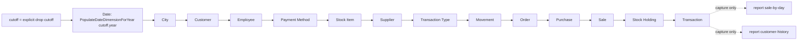
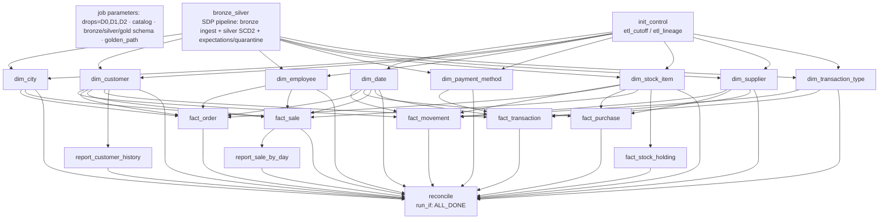

# WWI orchestration mapping: SSIS / SQL Agent to one Lakeflow job (Wave 0, workstream d)

**Sources (read-only):**
- Legacy: `Cognition-Partner-Workshops-mirror/daiwt-02-enterprise-etl` @ `bb42a64`. This is the same commit that `golden/manifest.json` records as `source.legacy_commit`.
- Migration: `Cognition-Partner-Workshops-mirror/daiwt-02-lakehouse-migration` `main` @ `dd46399`.

Paths prefixed `legacy:` are in the legacy repo. Paths prefixed `mig:` are in the migration repo.

**Labels:**
- **[V]** = verified by reading the code or the golden CSVs.
- **[I]** = inference or recommendation.


---

## 0. TL;DR

1. **Two "daily ETL" orchestrations exist. Only one of them produced the goldens.**
   - [V] `legacy:wwi-ssis/wwi-ssis/DailyETLMain.dtsx` is the original Microsoft sample. It is a strictly serial chain of 13 sequence containers that load 7 dimensions and then 6 facts, after a cutoff calculation and a Date dimension step.
   - [V] `legacy:sqlserver/agent/10_job_WWI_Daily_ETL.sql` runs a different package: the expanded `ssis/00_orchestration/Master_Daily_ETL.dtsx`. That package has 20+ phases and about 150 child packages (Oracle extract, staging, data quality, marts, C360), all on top of an `etl.*` batch framework.
   - [V] That framework does not exist on the live estate. `mig:golden/ssis_branches.json` and manifest `skipped_branches` list the missing `etl.*` procedures for all 205 expanded packages.
   - [V] The goldens come from `mig:golden/capture_sqlserver.py etl` (lines 661-701). That script replays **only** the DailyETLMain logic.
2. **The effective DAG is DailyETLMain's 13-entity chain.** It uses an explicit cutoff per drop (D1 `2016-06-14 00:00:00`, D2 `2016-06-21 00:00:00`). See §3.
3. **No off-workflow Agent job contributes to the 16 golden outputs** [V by capture path]. Several of them would mutate the same tables in a real estate, but none of them ran. The recommended re-homing is: none become separate Lakeflow jobs; drop the platform jobs; keep any wanted DQ/health behaviour inside the main job (expectations, a reconcile task, notifications). See §4.
4. **Proposal: one job, `wwi_daily_etl`, with 18 tasks** (§5):
   - 1 SDP pipeline task (bronze ingest of `inputs/<drop>` plus silver with expectations and quarantine).
   - 1 `dim_date` SQL task, 7 dimension SQL tasks and 6 fact SQL tasks.
   - 2 report SQL tasks and 1 reconcile task.
   - Dimensions run in parallel, then facts run in parallel. This replaces the legacy serial chain without changing the data dependencies.
5. **Per-drop replay is one job run.** The `drops` job parameter defaults to `D0,D1,D2`. The SDP update ingests all requested drops, and every gold task loops over the drops in order inside its own code.
   - Lineage keys are computed arithmetically, which makes the result independent of execution order.
   - Cutoff and lineage state live in Delta tables `etl_cutoff` and `etl_lineage` in the gold schema.
   - Rejected alternative: `for_each_task` over drops, with a nested `run_job_task`. It costs one parent run plus three child runs.

---

## 1. Scope classification (orchestration artefacts)

| Artefact | In / out | Why |
|---|---|---|
| `legacy:wwi-ssis/wwi-ssis/DailyETLMain.dtsx` (13 083 lines) | **IN, the authority** | Native package. The goldens replay exactly its entity order, clear statements and result sets (`mig:golden/README.md` §"`etl` follows the native package's entity order…"; `mig:golden/native_result_sets.json` and `native_destination_columns.json` have exactly the 13 keys City … TransactionType). |
| `legacy:wwi-ssis/wwi-ssis/Project.params` | IN (empty) | `<SSIS:Parameters />`. There are no project parameters. All state lives in package variables and DB tables. |
| `legacy:wwi-dw-ssdt/.../Integration/Stored Procedures/{GetLastETLCutoffTime,GetLineageKey,MigrateStaged*Data,PopulateDateDimensionForYear}.sql` | IN | Called by DailyETLMain against the DW. |
| `legacy:wwi-ssdt/.../Integration/Stored Procedures/Get*Updates.sql` (13) | IN | OLTP extract procedures. Each takes `@LastCutoff`/`@NewCutoff`, except `GetStockHoldingUpdates`, which takes no parameters. |
| `legacy:wwi-dw-ssdt/.../Integration/Tables/{ETL Cutoff,Lineage}.sql` | IN | Control state (§6). |
| `legacy:sqlserver/agent/10_job_WWI_Daily_ETL.sql` | IN as **schedule/ops intent only** | It runs `Master_Daily_ETL.dtsx`, not DailyETLMain. Reuse its 01:30 schedule, its single-open-batch rule and its failure-notification intent. |
| `legacy:ssis/00_orchestration/Master_Daily_ETL.dtsx` and `legacy:ssis/orchestration-plan.json` root `Master_Daily_ETL` | OUT (reference only) | Expanded estate: Oracle/ERP, files, marts and C360. It depends on missing `etl.usp_StartBatch`/`EndBatch`/`AssertRowCountReconciliation` (`ssis_branches.json` `packages["ssis/00_orchestration/Master_Daily_ETL.dtsx"] = 1` → `procedure_sets[1]`). It did not run for the goldens. |
| `legacy:sqlserver/agent/11..21_*.sql` and the `Master_*` packages they run | OUT for goldens; classified in §4 | They are schedule definitions only. `legacy:sqlserver/agent/README.md`: "Nothing in this directory has been run." |
| `legacy:sqlserver/agent/00..02_*.sql`, `90_install_all_agent_jobs.sql` | OUT | Categories, operators and proxies. These are platform concerns: use Databricks job notifications and service-principal run-as instead. |

---

## 2. DailyETLMain.dtsx: full control flow [V]

### 2.1 Package-level objects

| Kind | Name | Value / definition | Lines |
|---|---|---|---|
| Variable | `User::LastETLCutoffTime` | design value `4/11/2016 10:39:10 AM`; overwritten per entity | 19-58 (decl. at 25) |
| Variable | `User::LineageKey` | `0`; set per entity | 34 |
| Variable | `User::TableName` | set per entity by an Expression Task | 43 |
| Variable | `User::TargetETLCutoffTime` | design value `4/13/2016 11:25:23 AM`; computed once per run | 53 |
| Expression Task | **Calculate ETL Cutoff Time backup** | `@[User::TargetETLCutoffTime] = DATEADD("Minute", -5, GETUTCDATE())` | 60-74 |
| Expression Task | **Trim Any Milliseconds** | `TargetETLCutoffTime = DATEADD("Millisecond", 0 - DATEPART("Millisecond", T), T)` | ~9940-9955 |
| Execute SQL | **Ensure Date Dimension includes current year** | `DECLARE @YearNumber int = YEAR(SYSUTCDATETIME()); EXEC Integration.PopulateDateDimensionForYear @YearNumber;` | 76-91 (SQL at 89) |
| Sequence containers | 13 × `Load <Entity> Dimension/Fact` | below | City 93-875 … Transaction Type 9419-~9938 |
| Project parameters | none | `Project.params` is empty | — |

- No loops (For/ForEach), event handlers, transactions, checkpoints or `MaxConcurrentExecutables` override were found (grep for `EventHandler|TransactionOption|MaxConcurrent|ForEach` returned nothing).
- Every precedence constraint has the default `Success` value and no expression (all `Value=None`, `EvalOp=None`, `LogicalAnd=True`).
- **Error path:** none. Any task failure fails its container, which fails the package. There is no retry, no compensation and no logging beyond what the SSIS catalog records.

### 2.2 Top-level precedence (lines 9957-10078), strictly serial

```
Calculate ETL Cutoff Time backup → Trim Any Milliseconds → Ensure Date Dimension includes current year
→ Load City Dimension → Load Customer Dimension → Load Employee Dimension → Load Payment Method Dimension
→ Load Stock Item Dimension → Load Supplier Dimension → Load Transaction Type Dimension
→ Load Movement Fact → Load Order Fact → Load Purchase Fact → Load Sale Fact
→ Load Stock Holding Fact → Load Transaction Fact
```

**Parallelism:** none. The chain is one linear path, so the default `MaxConcurrentExecutables` setting has no effect.

### 2.3 Inside each sequence container (identical 6-step template)

| # | Task | Type | Statement | Bindings |
|---|---|---|---|---|
| 1 | Set TableName to `<Entity>` | Expression | `@[User::TableName] = "<Entity>"` | — |
| 2 | Get Lineage Key | Execute SQL (DW) | `EXEC Integration.GetLineageKey ?, ?;` | in: `TableName`, `TargetETLCutoffTime`; out: `LineageKey` (single row) |
| 3 | Truncate `<X>_Staging` | Execute SQL (DW) | `DELETE FROM Integration.<X>_Staging;` | — |
| 4 | Get Last `<Entity>` ETL Cutoff Time | Execute SQL (DW) | `EXEC Integration.GetLastETLCutoffTime ?;` | in: `TableName`; out: `LastETLCutoffTime` |
| 5 | Extract Updated `<Entity>` Data to Staging | Data Flow | OLE DB source on the OLTP `EXEC Integration.Get<X>Updates ?, ? WITH RESULT SETS(...)`, with ParameterMapping `@LastCutoff`←`LastETLCutoffTime`, `@NewCutoff`←`TargetETLCutoffTime`; OLE DB destination `[Integration].[<X>_Staging]` | Stock Holding: `EXEC Integration.GetStockHoldingUpdates` with no parameters (L6222-6235) |
| 6 | Migrate Staged `<Entity>` Data | Execute SQL (DW) | `EXEC Integration.MigrateStaged<X>Data;` | — |

Precedence inside a container is 1→2→3→4→5→6. City is the example (L833-874). The order is the same in all 13 containers.

**Line references:**
- City: GetLastETLCutoff L727-745, GetLineageKey L762-778, Migrate L796, Set TableName L811-813, Delete L829. Extract SQL L385-403, ParameterMapping L424.
- Other entities' Execute SQL statements: Customer 1426-1521, Employee 2040-2135, Movement 2742-2837, Order 3745-3840, Payment Method 4267-4362, Purchase 4966-5061, Sale 6032-6127, Stock Holding 6637-6732, Stock Item 7635-7730, Supplier 8322-8417, Transaction 9276-9371, Transaction Type 9798-9893.

**Note:** several fact containers name step 4 "Get Last Movement ETL Cutoff Time" (L2735, 3738, 4959, 6025, 6630, 9269). The parameter is still bound to `User::TableName`, so the entity-correct cutoff is read.

### 2.4 What the DW procedures do (state contract)

| Proc | Effect | Source |
|---|---|---|
| `Integration.GetLineageKey @TableName, @NewCutoffTime` | `INSERT Integration.Lineage (Data Load Started=SYSDATETIME(), Table Name, Data Load Completed=NULL, Was Successful=0, Source System Cutoff Time=@NewCutoffTime) OUTPUT Lineage Key` | `legacy:wwi-dw-ssdt/wwi-dw-ssdt/Integration/Stored Procedures/GetLineageKey.sql:5-20`; key from `Sequences/LineageKey.sql` |
| `Integration.GetLastETLCutoffTime @TableName` | `SELECT [Cutoff Time] FROM Integration.[ETL Cutoff] WHERE [Table Name]=@TableName` | `GetLastETLCutoffTime.sql:2-12` |
| `Integration.MigrateStaged<X>Data` | (a) picks the newest `Lineage` row for the entity with `Data Load Completed IS NULL` (e.g. `MigrateStagedPurchaseData.sql:11-15`); (b) resolves surrogate keys with an as-of lookup `s.[Last Modified When] > d.[Valid From] AND <= d.[Valid To]`, defaulting to `0` (e.g. `MigrateStagedSaleData.sql:19-32`); (c) writes the target; (d) sets the Lineage row completed and successful; (e) `UPDATE Integration.[ETL Cutoff] SET [Cutoff Time] = Lineage.[Source System Cutoff Time]` (e.g. `MigrateStagedCityData.sql:44-54`). All of this runs in one transaction. | per-proc files |
| `Integration.PopulateDateDimensionForYear @YearNumber` | Inserts every missing date of that year | `PopulateDateDimensionForYear.sql:9-19` |

**Write pattern per target** [V by grep of each proc]:

| Target | Write pattern | Source lines |
|---|---|---|
| Dimensions City / Customer / Employee / Payment Method / Stock Item / Supplier / Transaction Type | SCD2: close the current row (`UPDATE … SET [Valid To] = staged [Valid From] WHERE [Valid To] = @EndOfTime`), then `INSERT` | e.g. City 26-40 |
| Fact.Movement | `MERGE` on `[WWI Stock Item Transaction ID]` | 48-62 |
| Fact.Order | delete-by-`[WWI Order ID]`, then insert | 54-56 |
| Fact.Sale | delete-by-`[WWI Invoice ID]`, then insert | 54-60 |
| Fact.Purchase | delete-by-`[WWI Purchase Order ID]`, then insert | 36-46 |
| Fact.Transaction | insert only | 54 |
| Fact.Stock Holding | `TRUNCATE` + full insert | 28-32 |

**Dimension lookups per fact** [V by grep of `Dimension.` in each `MigrateStaged*Data.sql`]:

| Fact | Dimensions looked up |
|---|---|
| Movement | Customer, Supplier, Stock Item, Transaction Type |
| Order | City, Customer, Employee, Stock Item |
| Purchase | Supplier, Stock Item |
| Sale | City, Customer (incl. Bill To), Employee, Stock Item |
| Stock Holding | Stock Item |
| Transaction | Customer, Supplier, Payment Method, Transaction Type |

`Date Key` columns are carried as date values. They are not looked up.

---

## 3. What actually produced the goldens: the effective DAG

### 3.1 Capture path [V `mig:golden/capture_sqlserver.py`]

- `ENTITIES` (L21-35) lists the same 13 entities in DailyETLMain's container order: City, Customer, Employee, Payment Method, Stock Item, Supplier, Transaction Type, Movement, Order, Purchase, Sale, Stock Holding, Transaction.
- `CLEAR_SQL` (L36-39) mirrors the native clear statements, including the native Purchase clear statement (`DELETE FROM Integration.Order_Staging`).
- `etl()` (L661-701) runs these steps:
  1. Read-only preflight. For each entity, describe the `Get<X>Updates` result set (`native_result_sets.json`) and map it to staging columns (`native_destination_columns.json`).
  2. `EXEC Integration.PopulateDateDimensionForYear <cutoff.year>`. Note: this is **cutoff year, not current year**.
  3. For each entity, serially: `GetLineageKey(TableName, cutoff)` → clear staging → `GetLastETLCutoffTime` → `INSERT … EXEC OLTP.Integration.Get<X>Updates @LastCutoff=last, @NewCutoff=cutoff` (Stock Holding takes no parameters) → `MigrateStaged<X>Data`.
  4. Verify that all 13 lineage rows are completed and successful. Fail if every incremental extract returned zero rows (Stock Holding is excluded from that check).
- `REPORTS` (L40-50) are captured with plain SELECTs **after** the ETL run. They are not part of any legacy package:
  - `sale-by-day` = `SELECT [Invoice Date Key], COUNT_BIG(*), SUM([Total Including Tax]) FROM Fact.Sale GROUP BY … ORDER BY …`
  - `customer-history` = `SELECT [Customer Key],[WWI Customer ID],Customer,[Valid From],[Valid To] FROM Dimension.Customer ORDER BY [Customer Key]`
- Per `mig:golden/README.md`, the "advance" step (the OLTP simulation `DailyProcessToCreateHistory`) runs before `etl` to generate source activity. It is **not** part of the target DAG. It is the test-data generator.

### 3.2 Drops [V `mig:golden/manifest.json` `drops`, `capture-D*.json`, `outputs/*/tables/Integration.*.csv`]

| Drop | Source window (advance) | Last cutoff → new cutoff | Lineage keys | Notes |
|---|---|---|---|---|
| D0 | `null` | `2016-06-06 12:31:17` (unchanged) | 1-13 (`Data Load Started` 2016-06-06 12:36) | D0 outputs are the restored Microsoft DW backup. No ETL was run by the capture. |
| D1 | 2016-06-07 … 2016-06-13 | `2016-06-06 12:31:17` → `2016-06-14 00:00:00` | 14-26 | 13 rows, entity order as above |
| D2 | 2016-06-14 … 2016-06-20 | `2016-06-14 00:00:00` → `2016-06-21 00:00:00` | 27-39 | ditto |

`Integration.ETL_Cutoff.csv` (14 rows per drop): all 13 entities advance to the new cutoff. The `Date` row stays at `2012-12-31 00:00:00.0000000` in every drop, because no proc updates it.

`Integration.Lineage.csv` has 13 / 26 / 39 rows.

### 3.3 Skipped branches [V `manifest.skipped_branches` = `golden/ssis_branches.json`]

- `reason`: "Missing live procedures in both databases…"
- 91 deduplicated `procedure_sets` across 205 expanded `ssis/**` packages. Every set contains at least one missing `etl.*` logging/watermark/batch procedure, e.g. `etl.usp_LogPackageStart`, `usp_GetWatermark`, `usp_StartBatch`. Some sets also contain `stg.*` or `Integration.*` procedures.
- Consequence: every `Master_*` root, and every `DIM_*`/`FACT_*`/`AGG_*`/`MNT_*`/`DQ_*` package, was **not executable** on the live estate and contributed nothing.

### 3.4 Effective DAG



**Golden row evidence that this chain ran** [V]: the D2 lineage-key histogram per table.

| Table | D2 rows by lineage key |
|---|---|
| fact_sale | {11: 227 981, 24: 1 459, 37: 2 046} |
| fact_order | {9: 231 370, 22: 1 445, 35: 1 852} |
| fact_movement | {8: 236 667, 21: 1 462, 34: 1 854} |
| fact_transaction | {13: 99 585, 26: 705, 39: 842} |
| fact_stock_holding | {38: 227} (full reload each drop) |
| fact_purchase | {10: 8 358, 36: 113} |
| dim_customer | {0: 1, 2: 402} |
| dim_stock_item | {0: 1, 5: 671} |

Dimensions are unchanged in D1/D2, except one new Employee version in D2 (lineage 29).

**Report row counts:**

| Report | D0 | D1 | D2 |
|---|---|---|---|
| sale-by-day | 1 069 | 1 075 | 1 081 |
| customer-history | 403 | 403 | 403 |

dim_date has 1 461 rows (2013-01-01 … 2016-12-31) in all drops.

**Not in parity scope:** `Integration.ETL_Cutoff`/`Lineage` CSVs exist under `outputs/<drop>/tables`, but they are **not** in manifest `tables` (16 entries). `mig:src/parity/parity_check.py` will not check them unless they are added.

---

## 4. SQL Agent jobs and off-workflow packages

### 4.1 `WWI - Daily ETL` (`legacy:sqlserver/agent/10_job_WWI_Daily_ETL.sql`) [V]

- Enabled. Category `WWI ETL - Nightly`. Owner `sa`. E-mail/eventlog on failure to `WWI ETL On-Call` (L36-45).
- Schedule: `WWI - Nightly 0130`, daily at 01:30 instance-local time (L180-197). The comment explains the choice: after the 23:00 NA-Eastern close and the 22:00 UTC EU cut.

| Step | What | Success → | Failure → | Retries | Lines | Lakeflow mapping [I] |
|---|---|---|---|---|---|---|
| 1 Pre-flight | Fail if a DAILY `etl.Batch` is Running; fail if config `Daily.EnableLoad` ≠ 1 | 2 | 6 (notify) | 0 | 53-76 | `max_concurrent_runs: 1`, plus `queue.enabled`; the enable flag becomes the schedule pause status |
| 2 Master_Daily_ETL | SSIS catalog run, SYNCHRONIZED, logging level 1 | 3 | 5 | 2 × 15 min | 83-96 | The whole DAG (§5). Retry rationale (Oracle listener bounce) does not apply. |
| 3 Row-count reconciliation | `etl.usp_AssertRowCountTolerance @BatchId, @Scope='ALL'` (warn in DEV, error elsewhere) | 4 | 5 | 0 | 102-122 | `reconcile` task: bronze/silver/gold count balance + quarantine counts |
| 4 Post-load stats | `MNT_Update_Statistics.dtsx` | quit success | 6 | 1 × 5 min | 125-138 | **Drop** (platform; predictive optimization / ANALYZE) |
| 5 Mark batch failed | `etl.usp_EndBatch` on the open DAILY batch | 6 | 6 | 1 × 1 min | 141-164 | Not needed: the job run status is the batch status |
| 6 Notify | `ERR_Notify_Operations.dtsx` | quit failure | quit failure | 0 | 166-177 | `email_notifications.on_failure` / webhook |

### 4.2 Every other Agent job

The 16 golden outputs are the dims, facts and reports in `gold.*` (manifest `tables`). "Touches in-scope tables" below means the expanded package writes `Dimension.*`/`Fact.*` tables that are also golden. This is [V] by grepping each package for table names.

| Job (file) | Schedule / enabled | Packages / steps | Touches in-scope tables? | Affects the 16 goldens? | Re-home [I] |
|---|---|---|---|---|---|
| 11 Hourly Incremental | hourly 05:00-23:00, enabled | gate on DAILY batch running; set watermark `Hourly.SafeFloor`; `Master_Hourly_Incremental` (EXT_SQL_Orders/Invoices/Shipments → STG → DQ → `FACT_Load_Order`, `FACT_Load_Shipment`, `FACT_Load_OrderFulfilment` → `AGG_Refresh_DailySalesSummary`); 3-strike self-disable (L44-142) | Yes: `FACT_Load_Order` writes `[Fact].[Order]` | **No.** The package is skipped (missing `etl.usp_GetWatermark` etc.). The goldens are daily-batch only. | **Out of scope.** Intraday latency is not part of the demo. If ever needed, re-run the same job on a more frequent schedule; do not add a second job. |
| 12 Intraday Inventory | every 20 min 05:00-22:00, enabled | `Master_Intraday_Inventory` (`FACT_Load_Movement`, `FACT_Load_StockHolding`, INV marts, AGG inventory health); stale-feed check on `etl.RowCountAudit` (L41-122) | Yes: `[Fact].[Movement]`, `[Fact].[Stock Holding]` | **No** (skipped) | **Out of scope.** Same note as job 11. |
| 13 Customer Master Sync | daily 00:15, enabled | `Master_Customer_Sync` (Oracle customer extract, dedup, regional `DIM_{NA,EU,APAC}_Load_Customer` via `MigrateStagedCustomerDataV2`, C360); EU consent / APAC flagging / NA address steps (L42-148) | Yes: `[Dimension].[Customer]`, `[Dimension].[City]` | **No** (skipped; Oracle and `etl.*` absent) | **Out of scope.** These are regional GDPR-style rules on an ERP feed that is not in the goldens. |
| 14 File Ingestion | every 15 min, enabled | `Master_File_Ingestion` (partner/carrier files), archive, quarantine | No (staging/partner tables) | No | Out of scope |
| 15 Weekly Reference Refresh | Sun 03:00, enabled | `Master_Weekly_Reference_Load` (`REF_Load_DateDimension`, `REF_Load_PaymentMethod`, `REF_Load_TransactionType`, `REF_Load_UnknownMembers`, `DIM_Rekey_LateArriving`); staleness gate; referential screen | Yes: `[Dimension].[Date]`, `[Payment Method]`, `[Transaction Type]`; rekey writes `[Fact].[Sale]` | **No** (skipped) | Out of scope. The behaviour we need is covered by the main job: `dim_date` task and dims' SCD2. |
| 16 Weekly Maintenance | Sat 22:00, enabled | `Master_Weekly_Maintenance`, DBCC CHECKDB, purge staging, `MNT_Rebuild_Indexes` (`Integration.RebuildColumnstoreIndexes`), summary | No (physical only) | No | **Drop: platform concern** (Delta OPTIMIZE / predictive optimization) |
| 17 Month End | daily 04:00 calendar-gated, **ships disabled** (`@enabled = 0`, L32) | `Master_Month_End` (`FACT_Apply_Corrections` → `Fact.Order/Sale/Payment`, `FACT_Dedup_Sale` → `Fact.Sale` + `Sale Duplicate Archive`, monthly aggregates) | Yes: `[Fact].[Sale]`, `[Fact].[Order]` | **No** (disabled and skipped) | Out of scope. Document as a known gap: no month-end corrections or dedup are applied to the gold facts. |
| 18 Finance Close | monthly day 1 05:00, **ships disabled** (L33) | FX gate; `Master_Finance_Close`; tax reconciliation; `AGG_Refresh_FinanceCloseSummary` | No (finance marts) | No | Out of scope |
| 19 Reject Reprocessing | every 4 h, enabled | reject-queue check; `DQ_Reject_Reprocess`; `ERR_Retry_FailedSteps`; `ERR_Route_RejectedRows` | Indirectly (re-feeds staging) | No | **Fold into the main job** as SDP quarantine tables (`*_quarantine`). Reprocessing means the next run re-reads bronze. No separate job. |
| 20 Control History Purge | Sun 05:00, enabled | `etl.usp_PurgeControlHistory` on staging and DW (13/24/12 months; DW 13/84/24), `MNT_Purge_ControlHistory`, msdb history purge (L41-122) | No (`etl.*` control tables only; does not touch `Integration.Lineage`/`ETL Cutoff`) | No | **Drop** (platform: job-run history retention; Delta `VACUUM`) |
| 21 ETL Health Check | every 30 min, enabled | stuck batch / duration outliers; error/reject thresholds; watermark drift; disk; config assertion (L44-174) | No | No | **Drop as a job.** Express it as job `health` rules (`RUN_DURATION_SECONDS`), notifications, and SDP expectation metrics. |

### 4.3 Expanded `Master_Daily_ETL` (for completeness) [V `legacy:ssis/orchestration-plan.json` root 0]

**Parameters:** `BatchId`, `BusinessDate`, `EnvironmentCode`, `ReloadFullHistory`, `MaxParallelStreams=4`, `MaxExtractAttempts=3`, `RestartFromStep`.

**Phases:**
1. Start Batch
2. Extract Oracle (22 packages, 4 streams) and Extract SQL Server (21 packages, 3 streams), with an attempt-counter retry loop through `ERR_Retry_FailedSteps`
3. File Screen / Quarantine
4. Stage Load (24) and Stage Work Tables (4)
5. Data Quality (7), Referential Screen, Reject Routing, Rescreen
6. Reference Refresh (3)
7. Dimensions (15 packages, 3 streams)
8. Facts (23 packages, 4 streams)
9. Aggregates (2)
10. Sales / Inventory / Procurement marts
11. C360 Build / Publish
12. Publish Reporting Layer
13. Reconcile Row Counts
14. End Batch

**Failure handling:** a `Failure Handling` phase reached by Failure edges from extract and DQ.

**Restart:** expression edges keyed on `RestartFromStep`.

Useful **ideas** to carry over [I]:
- "Repair run" replaces `RestartFromStep`.
- `max_retries` replaces the attempt loop.
- Parallel streams become parallel tasks.

Nothing in this package is needed for parity.

---

## 5. Proposed Lakeflow job: `wwi_daily_etl` [I]

### 5.1 Design choices

| Choice | Detail |
|---|---|
| **One job, one run per replay** | Each run pays cluster/pipeline startup, so all drops are processed in a single run (§6). There is no per-entity job. |
| **Bronze + silver in one SDP pipeline** (`wwi_bronze_silver`) | Bronze: Auto Loader / `read_files` over `${var.golden_path}/inputs/<drop>/*.csv` (38 source tables plus `*.deleted.csv`), with an `_drop` column. Silver: `AUTO CDC … STORED AS SCD TYPE 2`, keyed by the manifest `primary_key` and sequenced by drop ordinal. For no-PK tables (the `*_Archive` temporal history tables), use whole-row identity. `@dp.expect_or_drop`, with rejects written to `<table>_quarantine` (replaces DQ_* and job 19). Silver therefore reconstructs the full source snapshot **as of each drop** (per `manifest.input_semantics.reconstruction`). |
| **Gold as SQL file tasks** on `${var.warehouse_id}` | One task per golden entity, mirroring the 13 `MigrateStaged*Data` procs plus `dim_date` and 2 reports. Each task does the following for each drop in `drops`: compute the extract window `(last_cutoff, new_cutoff]` from `etl_cutoff` and the manifest; derive the staged set from silver-as-of-drop (port of `Get<X>Updates`); resolve keys; write the target; then update `etl_lineage`/`etl_cutoff`. |
| **Parallelism** | Dimensions are mutually independent. Facts depend only on the dimensions they look up (§2.4). Facts are mutually independent. A serial chain is not needed, because lineage keys are computed, not sequenced (§6). |
| **Unit = task** | This keeps Mason's standing CI rule ("run only the unit that changed") with **one** job. CI runs `jobs run-now` with `only: [<task_key>, …]` (Jobs API `run_now.only`; to be verified against the CLI version in CI) instead of one bundle job per unit. A shared or multi-unit change runs the full job. |

Compatibility note: `mig:ci/run_units.py:13-15` currently runs `databricks bundle run <job>` once per registry unit. With a single job the registry becomes:

```json
{"wwi_daily_etl": {"job": "wwi_daily_etl", "outputs": ["gold.dim_city", "…", "gold.report_customer_history"]}}
```

Optionally add a per-output `task` field so that `classify_changes.py` can map changed SQL files to `only` task keys. This is a builder decision.

### 5.2 Tasks

| task_key | type | depends_on | run_if | retries | produces |
|---|---|---|---|---|---|
| `bronze_silver` | `pipeline_task` (SDP, serverless, `full_refresh: false`) | — | — | 1 | `${bronze_schema}.*`, `${silver_schema}.*`, `*_quarantine` |
| `init_control` | `sql_task.file` | — | — | 1 | creates or seeds `${gold_schema}.etl_cutoff` and `etl_lineage` (D0 seed = manifest `drops[0].last_cutoff`, lineage 1-13) |
| `dim_date` | `sql_task.file` | `init_control` | ALL_SUCCESS | 1 | `gold.dim_date` (years present in data ∪ cutoff years; **not** the current year) |
| `dim_city`, `dim_customer`, `dim_employee`, `dim_payment_method`, `dim_stock_item`, `dim_supplier`, `dim_transaction_type` | `sql_task.file` | `bronze_silver`, `init_control` | ALL_SUCCESS | 1 | 7 SCD2 dimensions |
| `fact_movement` | `sql_task.file` | `dim_customer`, `dim_supplier`, `dim_stock_item`, `dim_transaction_type`, `dim_date` | ALL_SUCCESS | 1 | `gold.fact_movement` |
| `fact_order` | `sql_task.file` | `dim_city`, `dim_customer`, `dim_employee`, `dim_stock_item`, `dim_date` | ALL_SUCCESS | 1 | `gold.fact_order` |
| `fact_purchase` | `sql_task.file` | `dim_supplier`, `dim_stock_item`, `dim_date` | ALL_SUCCESS | 1 | `gold.fact_purchase` |
| `fact_sale` | `sql_task.file` | `dim_city`, `dim_customer`, `dim_employee`, `dim_stock_item`, `dim_date` | ALL_SUCCESS | 1 | `gold.fact_sale` |
| `fact_stock_holding` | `sql_task.file` | `dim_stock_item` | ALL_SUCCESS | 1 | `gold.fact_stock_holding` |
| `fact_transaction` | `sql_task.file` | `dim_customer`, `dim_supplier`, `dim_payment_method`, `dim_transaction_type`, `dim_date` | ALL_SUCCESS | 1 | `gold.fact_transaction` |
| `report_sale_by_day` | `sql_task.file` (CREATE OR REPLACE TABLE … AS) | `fact_sale` | ALL_SUCCESS | 1 | `gold.report_sale_by_day` |
| `report_customer_history` | `sql_task.file` | `dim_customer` | ALL_SUCCESS | 1 | `gold.report_customer_history` |
| `reconcile` | `sql_task.file` (assertions via `raise_error`) or a notebook | all 15 gold tasks | **ALL_DONE** | 0 | row-count balance (silver vs gold per drop), quarantine counts, `etl_lineage` 13 rows per drop all successful; fails the run on breach (replaces Agent step 3) |

Notes:
- `bronze_silver` and `init_control` share no data dependency and start in parallel.
- Retries of 1 are only safe because every gold task is idempotent per drop (§6.3).
- `dim_date` is a dependency of facts only for FK semantics (date keys are carried, not looked up). It can be dropped from fact `depends_on` if desired.

Job-level settings:
- `max_concurrent_runs: 1` and `queue.enabled: true` replace Agent pre-flight step 1.
- `email_notifications.on_failure` replaces steps 5-6.
- `health.rules: RUN_DURATION_SECONDS > 3600` replaces job 21.
- `timeout_seconds: 7200`.
- Schedule `0 30 1 * * ?` (`timezone_id: UTC`; legacy is "instance local", unverified). PAUSED in dev via the existing `presets.trigger_pause_status: PAUSED`. Also PAUSED in prod; unpause is a manual choice.

### 5.3 Mermaid



### 5.4 Illustrative DABs YAML

The proposed file is `resources/wwi_daily_etl.job.yml`, with `include: [resources/*.yml]` added to `mig:databricks.yml`. It uses only the existing bundle variables (`catalog`, `bronze_schema`, `silver_schema`, `gold_schema`, `warehouse_id`, `golden_path`) plus one new variable, `daily_etl_pause_status`.

```yaml
# resources/wwi_daily_etl.pipeline.yml
resources:
  pipelines:
    wwi_bronze_silver:
      name: wwi_bronze_silver_${var.schema_suffix}
      catalog: ${var.catalog}
      schema: ${var.silver_schema}          # default target; bronze tables use fully-qualified names
      serverless: true
      channel: CURRENT
      photon: true
      libraries:
        - glob: { include: ../src/pipelines/wwi_bronze_silver/** }
      configuration:
        wwi.catalog: ${var.catalog}
        wwi.bronze_schema: ${var.bronze_schema}
        wwi.silver_schema: ${var.silver_schema}
        wwi.golden_path: ${var.golden_path}
```

```yaml
# resources/wwi_daily_etl.job.yml
variables:
  daily_etl_pause_status:
    default: PAUSED

resources:
  jobs:
    wwi_daily_etl:
      name: wwi_daily_etl
      max_concurrent_runs: 1
      queue: { enabled: true }
      timeout_seconds: 7200
      schedule:
        quartz_cron_expression: "0 30 1 * * ?"   # legacy WWI - Nightly 0130
        timezone_id: UTC
        pause_status: ${var.daily_etl_pause_status}  # dev preset forces PAUSED anyway
      email_notifications:
        on_failure: ["${workspace.current_user.userName}"]
      health:
        rules: [{ metric: RUN_DURATION_SECONDS, op: GREATER_THAN, value: 3600 }]
      parameters:
        - { name: drops,         default: "D0,D1,D2" }   # prod daily: the newest drop only
        - { name: catalog,       default: "${var.catalog}" }
        - { name: bronze_schema, default: "${var.bronze_schema}" }
        - { name: silver_schema, default: "${var.silver_schema}" }
        - { name: gold_schema,   default: "${var.gold_schema}" }
        - { name: golden_path,   default: "${var.golden_path}" }
      tasks:
        - task_key: bronze_silver
          pipeline_task: { pipeline_id: "${resources.pipelines.wwi_bronze_silver.id}", full_refresh: false }
          max_retries: 1
          min_retry_interval_millis: 60000

        - task_key: init_control
          sql_task: { warehouse_id: "${var.warehouse_id}", file: { path: ../src/sql/units/init_control.sql } }

        - task_key: dim_date
          depends_on: [{ task_key: init_control }]
          sql_task: { warehouse_id: "${var.warehouse_id}", file: { path: ../src/sql/units/dim_date.sql } }
          max_retries: 1

        # one block per dimension (city shown; customer, employee, payment_method, stock_item,
        # supplier, transaction_type are identical apart from task_key/file)
        - task_key: dim_city
          depends_on: [{ task_key: bronze_silver }, { task_key: init_control }]
          sql_task: { warehouse_id: "${var.warehouse_id}", file: { path: ../src/sql/units/dim_city.sql } }
          max_retries: 1

        - task_key: fact_sale
          depends_on:
            - { task_key: dim_city }
            - { task_key: dim_customer }
            - { task_key: dim_employee }
            - { task_key: dim_stock_item }
            - { task_key: dim_date }
          sql_task: { warehouse_id: "${var.warehouse_id}", file: { path: ../src/sql/units/fact_sale.sql } }
          max_retries: 1
        # fact_movement / fact_order / fact_purchase / fact_stock_holding / fact_transaction: see §5.2 edges

        - task_key: report_sale_by_day
          depends_on: [{ task_key: fact_sale }]
          sql_task: { warehouse_id: "${var.warehouse_id}", file: { path: ../src/sql/units/report_sale_by_day.sql } }

        - task_key: report_customer_history
          depends_on: [{ task_key: dim_customer }]
          sql_task: { warehouse_id: "${var.warehouse_id}", file: { path: ../src/sql/units/report_customer_history.sql } }

        - task_key: reconcile
          run_if: ALL_DONE
          depends_on:
            - { task_key: report_sale_by_day }
            - { task_key: report_customer_history }
            - { task_key: fact_movement }
            - { task_key: fact_order }
            - { task_key: fact_purchase }
            - { task_key: fact_stock_holding }
            - { task_key: fact_transaction }
            - { task_key: dim_date }
            - { task_key: dim_city }
            - { task_key: dim_employee }
            - { task_key: dim_payment_method }
            - { task_key: dim_supplier }
            - { task_key: dim_transaction_type }
          sql_task: { warehouse_id: "${var.warehouse_id}", file: { path: ../src/sql/units/reconcile.sql } }
```

Builder notes:
- Job parameters are pushed to tasks automatically. SQL files read them as named parameter markers, e.g. `IDENTIFIER(:catalog || '.' || :gold_schema || '.fact_sale')`. Verify job-parameter → `sql_task` file propagation on the workspace's CLI version. If propagation fails, pass `sql_task.parameters` explicitly per task.
- The SQL tasks need a looping construct for drops. Two options:
  - a SQL scripting `FOR` loop over `split(:drops, ',')` (DBSQL SQL scripting), or
  - notebook tasks on serverless if scripting is not suitable.

  Notebook tasks add serverless-compute startup per task, but not per run.
- Prod: the deploying SP already has CAN_MANAGE (`mig:databricks.yml:44-58`). Set `run_as` to the Devin-CI service principal if promotion requires it.

---

## 6. Per-drop replay, cutoff and lineage state [I unless marked]

### 6.1 Replay model

| Option | Job runs for D0→D2 | Ordering guarantee | Verdict |
|---|---|---|---|
| A. `drops` job parameter = single drop; run 3 times | 3 | drop-major (same as legacy) | simple, but 3× startup |
| B. `for_each_task` over `["D0","D1","D2"]` (concurrency 1) wrapping a `run_job_task` | 1 parent + 3 child | drop-major | rejected: child runs pay startup too, and the DAG is harder to read |
| **C. `drops="D0,D1,D2"`; the pipeline ingests all drops in one update; each gold task loops over the drops in order** | **1** | entity-major (each table processes D0, D1, D2 in order) | **recommended** |

Why C reproduces legacy semantics, even though legacy is drop-major (all 13 entities for D1, then all for D2):
- **Lineage keys:** assign them arithmetically instead of from a sequence:

  `lineage_key = 13 * drop_ordinal + entity_ordinal + 1`

  - `entity_ordinal` is the 0-based position in the DailyETLMain order: City 0 … Transaction 12.
  - `drop_ordinal` is 0 for D0, 1 for D1, 2 for D2.

  [V] This matches the goldens: D1 City = 14, Transaction = 26; D2 City = 27, Transaction = 39; D0 (shipped) 1-13 in the same order.
- **Surrogate keys** (identity-like: `sale_key`, `purchase_key`, dimension keys): these are per table, so entity-major processing assigns them in the same per-table drop order as legacy. Within a drop, keys follow staged order (see `00-units.md`).
- **Dimension as-of lookups** use `Last Modified When ∈ (Valid From, Valid To]` (§2.4). A row staged in drop d has `Last Modified When ≤ cutoff_d`. Dimension versions created in later drops have `Valid From > cutoff_d`, so they do not match. Lookups made after later dimension drops have loaded therefore give the same key as legacy (inference; holds when source temporal `ValidFrom` ≤ cutoff, which `Get*Updates` enforces via `ValidFrom <= @NewCutoff`, e.g. `GetCityUpdates.sql:42-50`).
- **Cross-drop staging carry-over** (Purchase): to match golden, `fact_purchase` keeps the previous drop's staged set in its loop state.
- **D0** is the shipped Microsoft DW baseline: lineage 1-13, cutoff `2016-06-06 12:31:17`. There are two ways to handle it:
  - (a) treat D0 as an initial full load with window `(2012-12-31, 2016-06-06 12:31:17]`, or
  - (b) seed D0 gold directly from the D0 output goldens.

  Wave 0 decision: (b) seed D0 from the D0 output goldens; D1/D2 run incrementally (see `00-units.md` P5).

Daily prod run (steady state, after cutover):
- `drops` = the newest drop folder, or a `business_date`. The same code applies.
- The prod "cutoff" comes from the manifest drop's `new_cutoff`. It is **not** `GETUTCDATE()-5min` (legacy L70-73): replayed drops need deterministic cutoffs.

### 6.2 Where state lives

| State | Legacy | Lakehouse |
|---|---|---|
| Per-entity cutoff | `Integration.[ETL Cutoff]` (`Table Name` PK, `Cutoff Time datetime2(7)`; `legacy:wwi-dw-ssdt/.../Tables/ETL Cutoff.sql`) | Delta `${catalog}.${gold_schema}.etl_cutoff (table_name STRING PK, cutoff_time TIMESTAMP_NTZ, drop STRING)`. It lives in the bundle-owned per-PR gold schema, so each PR is isolated and `ci/reset.sh` cleans it up. Seed `Date` = `2012-12-31` and never advance it (legacy behaviour). |
| Run lineage | `Integration.Lineage` (sequence key, start/end, success, source cutoff) | Delta `${gold_schema}.etl_lineage (lineage_key INT, table_name, drop, data_load_started, data_load_completed, was_successful, source_system_cutoff_time, job_run_id)`. `job_run_id` = `{{job.run_id}}`. Insert one row with `was_successful = false` at task start; update it at the end. |
| Batch | `etl.Batch` (expanded only) | Lakeflow job run (run id, status, repair). No table. |
| Watermarks (`etl.usp_Get/SetWatermark`) | expanded only | not needed. SDP checkpoints handle bronze/silver incrementality. |

Note: `ETL_Cutoff` and `Lineage` can optionally be added to manifest `tables` as `gold.etl_cutoff`/`gold.etl_lineage`. They need snake_case headers, which they already have in the CSVs. The Lineage timestamps are declared nondeterministic, so a column-exclusion policy would be needed, which the current harness does not support ("No … ignored columns").

### 6.3 Idempotency and retry

- Each gold task guards each drop:
  - skip if `etl_cutoff.cutoff_time >= new_cutoff_d` **and** `etl_lineage` has a successful row for (`table`, `d`);
  - otherwise rewrite that drop's contribution.
- Delete-then-insert facts (Order, Sale, Purchase) and MERGE facts (Movement) are naturally idempotent per drop if the same staged set is recomputed from silver-as-of-drop.
- Fact.Transaction is insert-only and Stock Holding is a full reload, so both need the guard above.
- `etl_cutoff` is updated after the target write, in the same task. There is no multi-table atomicity, which is why the skip guard checks lineage success, not cutoff alone.
- Retries (`max_retries: 1`) are only enabled because of this guard. A failed run is resumed with **Repair run**, which reruns only the failed and downstream tasks. That replaces `RestartFromStep`.

---

## 7. Builder task list (suggested)

1. `src/pipelines/wwi_bronze_silver/`: bronze `read_files` per input CSV with `_drop`; silver AUTO CDC SCD2 by manifest PK / whole-row identity; expectations with quarantine; `*.deleted.csv` handling.
2. `init_control.sql`: create and seed `etl_cutoff`/`etl_lineage` from the manifest drops (D0 `last_cutoff`, lineage 1-13).
3. 7 dimension SQL units: port `Get<X>Updates` (temporal `FOR SYSTEM_TIME AS OF` → silver SCD2 as-of) and `MigrateStaged<X>Data` (SCD2 close and insert).
4. `dim_date.sql`: seed 2013-2016, matching the golden 1 461 rows.
5. 6 fact SQL units, with the write patterns in §2.4.
6. 2 report units, matching `capture_sqlserver.py:40-50` exactly.
7. `reconcile.sql`.
8. Job YAML (§5.4); registry/CI change to a single job with task-level `only`.
9. Tests:
   - offline YAML/DAG test asserting the `depends_on` edges in §5.2;
   - lineage-key formula test against `outputs/D2/tables/Integration.Lineage.csv`.
